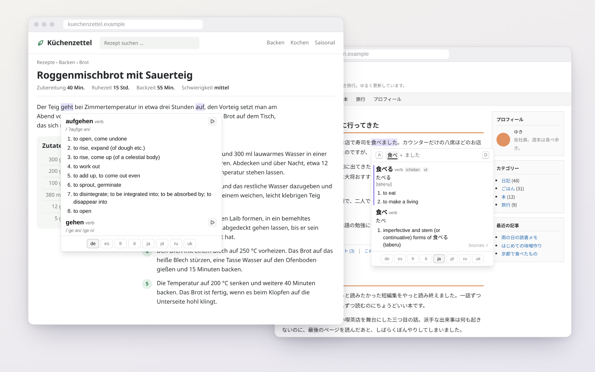

<p align="center"></p>

<h1 align="center">DaDict</h1>

<p align="center">
<a href="https://github.com/d0-lang/extension/releases/latest">Download</a> · <a href="#privacy">Privacy</a> · <a href="https://github.com/d0-lang/dict-server-ts">The server</a> · <a href="https://github.com/d0-lang/protocol">Protocol</a>
</p>

<picture>
  <source media="(prefers-color-scheme: dark)" srcset="docs/screenshot-dark.png">
  
</picture>

A browser extension for looking up words on any page, using dictionary servers you choose.

Hold <kbd>Alt</kbd> over a word, or right-click it and choose **Look up**. On a phone, long-press it and tap **Look up**. A popover shows the dictionary entries: meanings, part of speech, grammar labels, IPA and pronunciation. Works in Chrome and Firefox, and in Firefox for Android.

DaDict has no dictionary of its own. You add servers that speak the [d0 lookup protocol](https://github.com/d0-lang/protocol) and pick which of their languages to use. Each language is answered by one server.

To start, add **DaDict public**, `https://server.dadict.com`: German, Spanish, French, Italian, Japanese, Korean, Chinese, Polish, Russian and Ukrainian, explained in English. Or [run your own](https://github.com/d0-lang/dict-server-ts#run-your-own).

## Features

- **Lookup on any page.** Hold <kbd>Alt</kbd> over a word, or use the context menu on a word or selection. On a phone, select a word and tap the **Look up** button under it.
- **Clickable subtitles.** On YouTube, the ARD Mediathek, tagesschau.de, ZDF, Arte and RTVE Play, and on other sites whose videos have subtitle tracks, like Vimeo, click a word in the subtitles to look it up. The video pauses while the lookup is open, and the line before stays above the current one. Right-click a line to copy it.
- **Anki**. Click <kbd>Q</kbd> to add a word to the flashcard queue, than if needed edit what u want to keep (remove senses, edit the sentence)
- **Video player.** Watch a video file from your computer with SRT, WebVTT or ASS subtitles you can click, from **Watch a video file** in the popup.
- **Phrases.** With the sentence around the word, a server can find the phrase it belongs to and highlight its pieces.
- **Several languages.** The page's language is detected, so the right server answers. The language you pick in the popover stays the default for that page.
- **Keyboard.** <kbd>W</kbd> / <kbd>S</kbd> scroll the popover, <kbd>A</kbd> / <kbd>D</kbd> move between the parts of a split word, like _Rettung_ and _Fonds_ in _Rettungsfonds_, <kbd>E</kbd> plays the pronunciation, <kbd>Esc</kbd> closes it.
- **Grammar labels explained.** Hover or tab to a label like _pf_ to see what it stands for, when the server explains its labels.
- **Sources.** The settings credit the material a server's answers are built from, and the popover links each entry and recording to its page.
- **Light and dark themes**, following the system or set by hand.

## Privacy

DaDict only talks to the servers you add.

- **What is sent:** the looked up word and its language. A server that supports it can also get the sentence the word is in. You choose this for each server when you add it: from all sites, from all sites except blocked ones, or never.
- **Blocked sites:** sites like mail or documents can be listed in Settings. Their sentences only go to servers set to get sentences from all sites.
- **On YouTube**, DaDict reads the caption track the player downloads, to show it with clickable words. Tracks stay in the tab's memory and are never stored or sent anywhere. A lookup sends the word and, if you allow sentences for that server, the subtitle it is in, the same as a sentence on any page. DaDict makes no requests to YouTube itself.
- **On other sites**, DaDict reads the subtitle tracks the page's video already has, in the same way.
- **Video files** you open in the player stay on your computer. They are played and read in the browser and never uploaded.
- **Pronunciation audio** is played only when you ask, over HTTPS, from the answering server's own host or `upload.wikimedia.org`.
- **Source links** in the popover go only to the sites a server credits in its signed metadata, like Wiktionary, and open without telling that site which page you were reading.
- **Nothing else** leaves the browser. There is no analytics or tracking. Settings are kept in the browser's extension storage.

Servers sign what they send with an Ed25519 key. DaDict keeps the key from when you added the server and warns you if it changes.

## Permissions

| Permission      | Why                                                                 |
| --------------- | ------------------------------------------------------------------- |
| `<all_urls>`    | Find the word under the cursor on any page, and reach your servers. |
| `storage`       | Keep your servers, languages and settings.                          |
| `contextMenus`  | The **Look up** item in the right-click menu.                       |
| `notifications` | Tell you when a server moved or its key changed.                    |
| `alarms`        | Check your servers once a day while the browser stays open.         |

## Development

Requires [Bun](https://bun.sh) 1.4.4. Node.js is not needed, since Bun runs the build tools itself.

```sh
bun install
bun run dev            # Chrome, with live reload
bun run dev:firefox    # Firefox, with live reload
```

| Command                 | What it does                                           |
| ----------------------- | ------------------------------------------------------ |
| `bun run build`         | Production build for Chrome, in `.output/chrome-mv3`   |
| `bun run build:firefox` | Production build for Firefox, in `.output/firefox-mv2` |
| `bun run zip`           | Zip the Chrome build for the store                     |
| `bun run zip:firefox`   | Zip the Firefox build, plus a zip of the sources       |
| `bun run check`         | Type check                                             |
| `bun run test`          | Unit tests, and layout tests in Chromium               |
| `bun run format`        | Format with Prettier                                   |
| `bun run mock-server`   | Test dictionary servers on `http://localhost:8787`     |

Tests named `*.browser.test.ts` need real layout, so they run in headless Chromium. Install it once with `bunx playwright install chromium`.

The mock server runs a set of dictionary servers for trying out adding servers, key changes, moves and failures. Open `http://localhost:8787` for the list and what each one should do.

### Layout

| Path                            | What is there                                                                     |
| ------------------------------- | --------------------------------------------------------------------------------- |
| `src/entrypoints/background`    | Lookups, the context menu, and the server check at start                          |
| `src/entrypoints/content`       | Wiring the popover and subtitles into pages, YouTube's and other sites' subtitles |
| `src/entrypoints/player`        | The video player for files on your computer                                       |
| `src/entrypoints/popup`         | The toolbar button's popup                                                        |
| `src/entrypoints/setup`         | The settings page                                                                 |
| `src/lib/dict`                  | The protocol client: handshake, signatures, lookup                                |
| `src/lib/page`                  | Finding the word and its sentence on a page                                       |
| `src/lib/popover`               | The popover, also drawn in settings                                               |
| `src/lib/subtitles`             | Clickable subtitles over a video                                                  |
| `src/lib/storage.ts`            | Everything kept in extension storage                                              |
| `scripts/mock-server.ts`        | The test dictionary servers                                                       |

Built with [WXT](https://wxt.dev), [Svelte](https://svelte.dev), [Tailwind CSS](https://tailwindcss.com) and [shadcn-svelte](https://shadcn-svelte.com).

## Building the Firefox add-on from source

These steps rebuild the add-on submitted to addons.mozilla.org, file for file.

Tested on:

- Arch Linux, x86-64
- Bun 1.4.4

Dependencies are pinned by `bun.lock`. npm does not read it, so use Bun. Node.js is not needed, since Bun runs the build tools itself.

1. Install Bun 1.4.4: `curl -fsSL https://bun.sh/install | bash -s "bun-v1.4.4"`
2. In the unpacked source folder, install the exact dependency versions:

   ```sh
   bun install --frozen-lockfile
   ```

3. Build:

   ```sh
   bun run build:firefox
   ```

`BUILD_COMMIT` in the source folder names the commit the add-on was built from, which the report page shows next to the version. Keep it: without it the build names no commit, and the report page's script differs from the submitted one.

The add-on is in `.output/firefox-mv2`. Its files match the submitted zip. `bun run zip:firefox` packs it into `.output/dadict-<version>-firefox.zip`.

## Credits

The popover preview in Settings plays two recordings from Wikimedia Commons, both by Dvortygirl under [CC BY-SA 3.0](https://creativecommons.org/licenses/by-sa/3.0/): [En-us-mother.ogg](https://commons.wikimedia.org/wiki/File:En-us-mother.ogg) and [En-us-mom.ogg](https://commons.wikimedia.org/wiki/File:En-us-mom.ogg). They stream from Commons when you press play, and the preview's Sources view links them.

## Contributing and licence

[CONTRIBUTING.md](CONTRIBUTING.md) says what helps and how to send a change. The code is under the [MIT licence](LICENSE).
